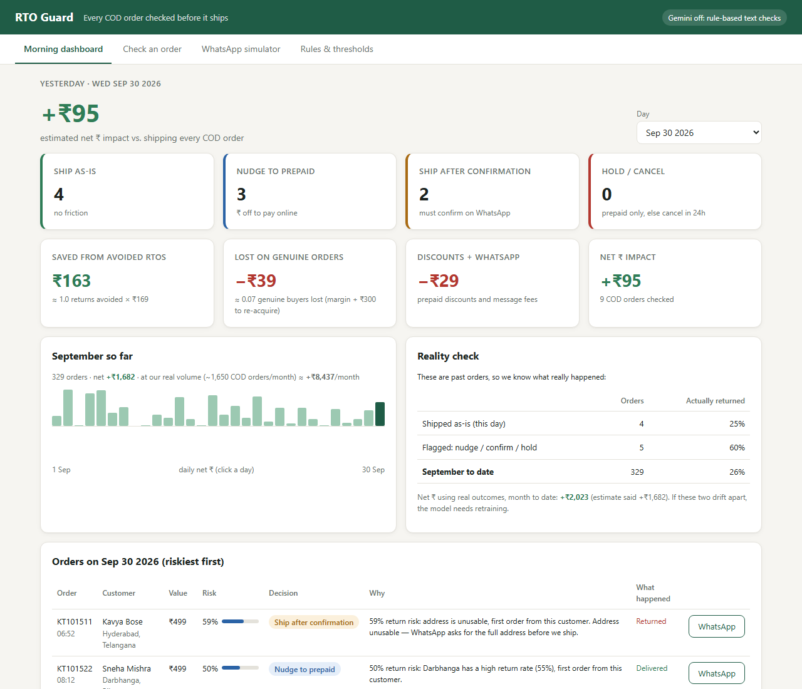
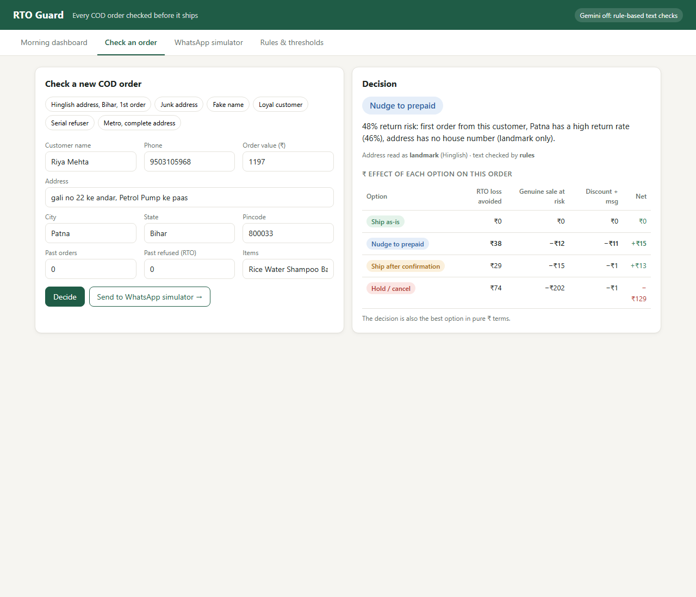
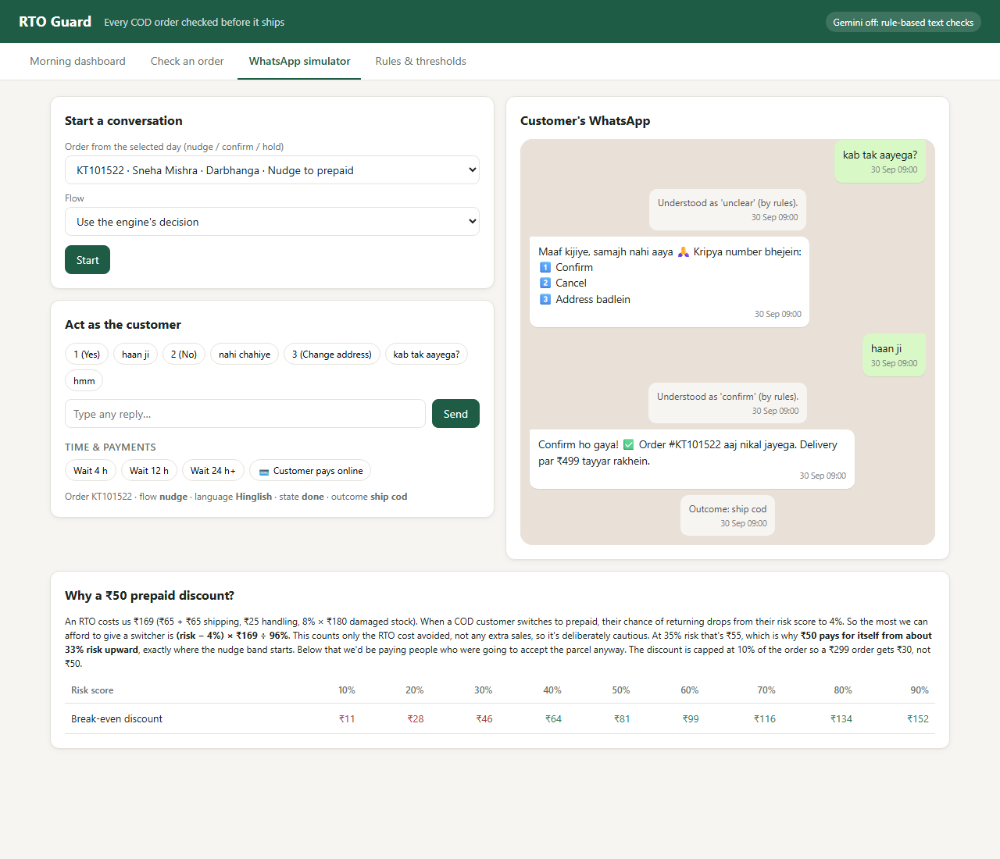
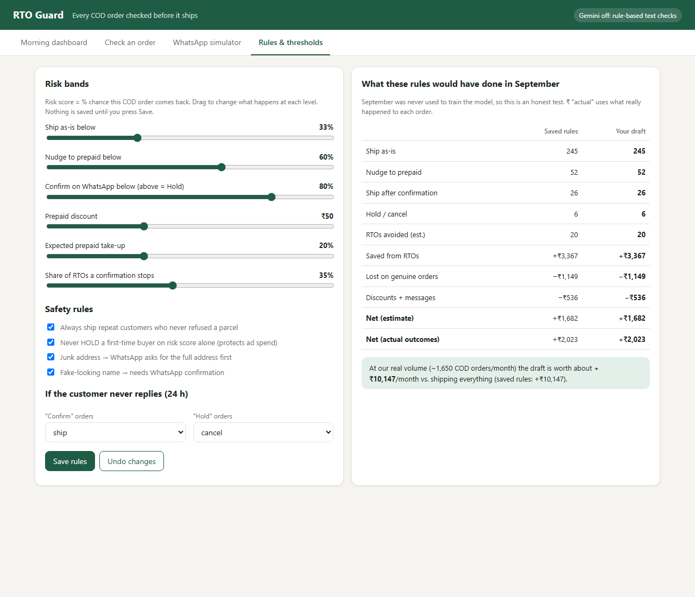

# RTO Guard

**Decides what to do with every Cash-on-Delivery order before it ships.** Each order gets one of *Ship as-is*, *Nudge to prepaid*, *Ship after confirmation* or *Hold / cancel*, along with a plain-English reason and the ₹ effect of that choice.

> **Result on September** (a month the model never saw while training, 329 COD orders):
> Ops' "cancel risky orders" → **−₹16,345** · "stop COD in bad pincodes" → **−₹16,883** · **RTO Guard → +₹2,023** (≈ +₹10k/month at full volume).
> The reasons are in the [business memo](docs/Business_Memo.pdf).



---

## Run it (about 2 minutes)

Needs **Python 3.10+**. The only packages are pandas, numpy and PyYAML.

```bash
git clone <this repo> && cd rto-guard
pip install -r requirements.txt
python run.py
```

Your browser opens on **http://localhost:8000**. That's it. A trained model and September's decisions are already included, so nothing else has to run first.

**Optional: turn on Gemini** for reading addresses, names and free-text WhatsApp replies:
```bash
cp .env.example .env      # then paste your key: GEMINI_API_KEY=...
```
Without a key, rule-based checks are used and everything still works. The header shows which mode is on.

### Other commands

| Command | What it does |
|---|---|
| `python scripts/analyze.py` | Prints every data finding quoted in the memo |
| `python scripts/train.py` | Retrains on Apr–Aug, prints September accuracy and calibration |
| `python scripts/backtest.py` | Replays September: per-bucket ₹ and the Ops / Marketing / RTO Guard comparison |
| `python -m unittest discover tests` | 26 tests (or `pytest`) |

---

## What's inside

### The four screens

| | |
|---|---|
| **Morning dashboard**: yesterday's orders in each of the 4 buckets, ₹ saved from avoided RTOs, ₹ lost on genuine orders we stopped, discounts and messaging, **net ₹**, the month so far, and a *reality check* comparing the estimate with what really happened. |  |
| **Check an order**: type in any order (or pick an example: Hinglish address, junk address, fake name, serial refuser…) and see the decision, the reason, and the ₹ effect of all four options side by side. |  |
| **WhatsApp simulator**: a mock of the WhatsApp Business API. Play the customer: tap yes / no / change address, type anything, *wait 4h / 24h*, or *pay online*. Includes the discount maths. |  |
| **Rules & thresholds**: sliders for every threshold, plus the safety rules. As you drag, it shows what the new rules would have done to September in ₹. **Save** writes `config/rules.yaml`. No code involved. |  |

### How a decision is made

```
 order ──► text checks ─────────► risk model ─────► risk bands ─────► safety rules ─────► action + reason + ₹
           (Gemini, or rules       (logistic          (rules.yaml:      (rules.yaml:
            if no key): address    regression,        33% / 60% / 80%)  loyal → ship,
            quality, fake name     10 features)                         2+ RTOs → hold,
                                                                         1st-timer never held
                                                                         without evidence…)
```

**Where the LLM is used, and why only there.** Gemini answers two questions: *"Can a courier find this address?"* (including Hinglish: "Hanuman Mandir ke peeche wala ghar") and *"Is this a real name?"* It also reads free-text WhatsApp replies. Everything numeric is code: the risk score, pincode history, thresholds, the ₹ maths. Code is calibrated, free, gives the same answer every time and can be explained line by line. The LLM's labels are *inputs* to the model, never the decision. Details in the [decision log](docs/DECISION_LOG.md).

**The risk model.** Logistic regression in numpy, trained on April–August and tested on September: **AUC 0.74**, and well calibrated (orders scored 32–42% returned 37% of the time). The features are customer history, city return rate (pincode → city → state, shrunk so a pincode with 2 orders can't brand an area), address quality, fake name, invalid phone, order value > ₹1,500 and first order.

### Repository map

```
run.py                      one command: train if needed, start the dashboard
config/rules.yaml           ← every threshold and ₹ assumption, with plain-English notes
src/rto_guard/
  data.py                   loading + cleaning (duplicates, 6 status spellings, phone formats)
  text_checks.py            address / name quality: Gemini, with rule fallback
  model.py                  risk model + pincode→city→state area rates
  economics.py              all ₹ maths (RTO cost, margin, discount break-even)
  engine.py                 the decision engine: bands + safety rules + reasons
  whatsapp.py               conversation state machine, EN + Hinglish copy, reply reading
  backtest.py               replay past orders, ₹ by estimate and by true outcome
  server.py                 tiny standard-library web server + JSON API
app/index.html              the dashboard (one file, no build step)
scripts/                    analyze.py · train.py · backtest.py
tests/                      26 unit tests
docs/
  Business_Memo.pdf         ← the memo for the founder (memo.html is the source)
  DECISION_LOG.md           choices, alternatives, and why
  AI_USAGE_LOG.md           AI tools used, and where they were wrong
  WHATSAPP_FLOW.md          message timing, language, reply handling, discount maths
artifacts/                  trained model + September decisions (regenerated by the scripts)
data/orders_sample.csv      the dataset provided
```

### API (used by the dashboard; handy for a Shopify webhook later)

| Method | Path | |
|---|---|---|
| `POST` | `/api/decide` | `{"order": {...csv columns...}}` → action, risk, reason, ₹ per option |
| `GET` | `/api/dashboard?date=2026-09-30` | bucket counts, saved / lost / net, orders |
| `GET` / `POST` | `/api/config`, `/api/config/preview`, `/api/config/save` | read, test and save rules |
| `POST` | `/api/wa/start`, `/api/wa/reply`, `/api/wa/wait`, `/api/wa/pay` | mock WhatsApp API |

---

## Submission checklist

1. **Repo + README**: you're reading it.
2. **Business memo**: [`docs/Business_Memo.pdf`](docs/Business_Memo.pdf)
3. **Decision log**: [`docs/DECISION_LOG.md`](docs/DECISION_LOG.md)
4. **AI usage log**: [`docs/AI_USAGE_LOG.md`](docs/AI_USAGE_LOG.md)
